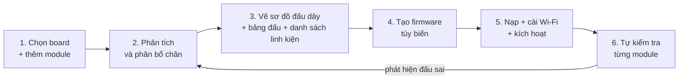

# Robo Dev v2 - đề xuất: thêm module, tự phân bổ chân, vẽ sơ đồ đấu dây, tạo firmware tùy biến

> Bản đề xuất cho phiên bản 2, viết trước khi có Robo Dev v1 (13/10/2026). "v1" trong tài liệu này là phiên bản công cụ đầu tiên; thiết kế v1 hiện hành nằm ở [../document.md](../document.md).

Bản nháp đề xuất, ngày 13/10/2026. Viết sau khi hoàn thành v1 (xem `document.md`). Những chỗ chưa kiểm chứng được đánh dấu **[cần kiểm chứng]**; không có con số ước lượng công sức vì chưa có cơ sở.

## 1. Mục tiêu của v2

v1 chỉ hỗ trợ đúng một cấu hình phần cứng cố định. v2 cho người dùng tự chọn bộ module của riêng mình và để chương trình lo phần còn lại theo chuỗi:

**chọn board và module → phân tích và phân bổ chân → vẽ sơ đồ đấu dây → tạo firmware tùy biến → nạp → tự kiểm tra từng module.**

Người dùng mục tiêu: người lắp robot/thiết bị riêng, biết đấu dây nhưng không biết lập trình ESP-IDF. Thành công của v2 là một người chưa từng thấy mã nguồn dựng được robot mới (ví dụ thêm servo, thêm cảm biến thứ hai, đổi màn hình) và kết nối xiaozhi.me mà không phải sửa code.



## 2. Những bài học từ v1 trở thành yêu cầu của v2

Mọi lỗi dưới đây đã gặp thật khi làm v1; v2 phải bắt được chúng trước khi người dùng đụng tới mạch.

| Đã gặp ở v1 | Hậu quả | Yêu cầu cho v2 |
| --- | --- | --- |
| Mạch động cơ nối GPIO43/44, trùng UART0 của cổng log | Log mất giữa chừng, khó nạp | Bộ phân bổ biết chân nào dành cho console và tránh |
| LCD dùng GPIO19/20, trùng USB native | Cổng USB native không bao giờ hiện lên máy tính | Bộ phân bổ biết chân USB và báo hệ quả khi dùng |
| VL53L0X trên GPIO45, chân strapping có điện trở kéo lên | Có thể làm mạch không khởi động | Gắn cờ chân strapping (GPIO0, 3, 45, 46 trên ESP32-S3) kèm điều kiện an toàn |
| Ảnh mic bị mờ, chưa có ảnh mạch động cơ | Nhãn chân trong tài liệu không chắc chắn | Mỗi module có trạng thái "đã xác nhận / chưa xác nhận" và yêu cầu ảnh rõ nhãn |
| Chiều quay bánh phụ thuộc cách đấu dây | Robot đi ngược | Bước tự kiểm tra có từng bánh và nút "đảo chiều" |
| Nạp đầy đủ từ 0x0 ghi đè vùng NVS | Mất Wi-Fi mỗi lần nạp | Mặc định nạp nhanh giữ Wi-Fi; chỉ nạp đầy đủ khi đổi bảng phân vùng |
| Thiết bị còn liên kết agent thì server không cấp mã | Người dùng không thấy mã kích hoạt | Hiện hướng dẫn hủy liên kết ngay khi không có mã |
| ESP-IDF từ chối chạy trong môi trường MSYS/Git Bash; PowerShell mới mở chặn `export.ps1` | Build nền thất bại | Bộ chạy build tự xóa biến MSYS và dùng `-ExecutionPolicy Bypass` (đã sửa ở v1) |
| Dòng lệnh COM bị cắt ở 512 byte, NVS chỉ 16 KB (0x4000) | Hồ sơ lớn không lưu được | Giao thức chia mảnh có tổng kiểm tra; giới hạn kích thước cấu hình nêu rõ |

## 3. Mô hình dữ liệu

### 3.1 Danh mục board

Mỗi board là một file mô tả bảng chân thật: thứ tự chân in trên mạch (như ảnh ESP32-S3-N16R8 đã chụp), và thuộc tính từng chân.

```json
{
  "id": "esp32s3-n16r8-dual-usbc",
  "chip": "esp32s3", "flash_mb": 16, "psram": "octal-8mb",
  "header": {
    "left":  ["3V3","3V3","RST","4","5","6","7","15","16","17","18","8","3","46","9","10","11","12","13","14","5Vin","GND"],
    "right": ["GND","TX","RX","1","2","42","41","40","39","38","37","36","35","0","45","48","47","21","20","19","GND","GND"]
  },
  "pins": {
    "43": { "reserved": "uart0_tx", "note": "log qua cổng COM" },
    "44": { "reserved": "uart0_rx" },
    "19": { "reserved": "usb_dm", "free_if": "không cần USB native" },
    "20": { "reserved": "usb_dp", "free_if": "không cần USB native" },
    "0":  { "strapping": true, "note": "nút BOOT" },
    "3":  { "strapping": true }, "45": { "strapping": true }, "46": { "strapping": true },
    "35": { "reserved": "psram_octal" }, "36": { "reserved": "psram_octal" }, "37": { "reserved": "psram_octal" },
    "48": { "onboard": "ws2812" }
  },
  "peripherals": { "i2s": 2, "spi_user": 2, "i2c": 2, "ledc_channels": 8, "rmt_tx": 4 }
}
```

Các giá trị về chân dành riêng, chân strapping và số bộ ngoại vi lấy từ datasheet ESP32-S3 và từ chính những gì đã gặp ở v1. **[cần kiểm chứng]** từng dòng với datasheet khi dựng bảng chính thức; đặc biệt GPIO33-37 trên biến thể N16R8.

### 3.2 Danh mục module

Mỗi module là một mô tả khai báo (không chứa code), gồm giao tiếp, chân, nguồn và driver nào trong firmware dùng được.

```json
{
  "id": "max98357a",
  "category": "audio_out",
  "name": "Khuếch đại I2S MAX98357A",
  "verified": true,
  "photo": "max98357a.jpg",
  "pin_order_on_module": ["LRC","BCLK","DIN","GAIN","SD","GND","Vin"],
  "interface": { "type": "i2s_tx", "signals": { "LRC": "ws", "BCLK": "bclk", "DIN": "dout" } },
  "unused_pins": ["GAIN", "SD"],
  "power": { "supply": ["5V","3V3"], "preferred": "5V", "logic_level_v": 3.3 },
  "outputs": [{ "name": "loa", "kind": "speaker_terminals", "polarity": ["−","+"] }],
  "firmware": { "driver": "audio.i2s_simplex_out", "tools": ["self.audio_speaker.set_volume"] }
}
```

Các loại giao tiếp cần hỗ trợ từ đầu, vì chúng đã có trong dự án gốc hoặc trong v1:

| Nhóm | Ví dụ module | Giao tiếp | Ghi chú ràng buộc |
| --- | --- | --- | --- |
| Âm thanh vào | INMP441 | I2S (WS, SCK, SD) | Cần một bộ I2S; chân L/R chọn kênh |
| Âm thanh ra | MAX98357A | I2S (LRC, BCLK, DIN) | Dùng chung bộ I2S với mic nếu cùng xung nhịp (kiểu duplex) hoặc bộ riêng (kiểu simplex như v1) |
| Màn hình | ST7789 1,54" (7 chân) | SPI (SCL, SDA, RST, DC) | Một số module nối CS xuống GND (không cần chân CS) |
| Cảm biến khoảng cách | VL53L0X | I2C (SDA, SCL) | Địa chỉ 0x29; nhiều cảm biến cùng địa chỉ cần chân SHUT riêng |
| Truyền động | Mạch H-bridge 4 ngõ vào | 4 chân PWM | Cần 4 kênh LEDC; không dùng chân console |
| LED | WS2812 | RMT, 1 chân | Một bộ RMT |
| Nút, rơ-le, còi, servo, ADC | Phổ thông | GPIO, PWM, ADC | Driver chung "GPIO/PWM/ADC" |
| Camera | OV3660/OV2640 | DVP, nhiều chân cố định | Chiếm khối chân lớn; board phải có đầu nối camera |

### 3.3 File dự án

`*.robodev.json` gộp: board đã chọn, danh sách module (kèm tên đặt cho từng cái), kết quả phân bổ chân, hồ sơ cấu hình v1, và mã băm của sản phẩm sinh ra (sơ đồ, firmware). Mở lại file là tái tạo được toàn bộ.

## 4. Bộ phân tích và phân bổ chân

Đầu vào: board + danh sách module. Đầu ra: bảng gán (tín hiệu → chân) hoặc danh sách xung đột có giải thích.

Thứ tự xử lý:

1. **Loại chân cấm:** chân dành riêng (console, USB, PSRAM, flash) và chân board đã dùng sẵn (LED onboard). Chân USB chỉ được dùng khi người dùng chấp nhận mất cổng USB native.
2. **Kiểm tra tài nguyên ngoại vi:** số bộ I2S, SPI, I2C, kênh LEDC, kênh RMT mà các module cần so với số board có. Báo thiếu kèm gợi ý (ví dụ gộp mic và loa vào một bộ I2S duplex).
3. **Gộp bus dùng chung:** các module I2C chia chung SDA/SCL (kiểm tra trùng địa chỉ); các module SPI chia chung SCLK/MOSI và có CS riêng.
4. **Gán chân:** tìm phép gán thỏa các ràng buộc, ưu tiên (a) tránh chân strapping, (b) chân kề nhau trên đầu nối để dây gọn và ít cắt nhau, (c) giữ nguyên gán cũ khi người dùng thêm module mới (không bắt đấu lại dây).
5. **Cảnh báo điện:** mức logic 3,3 V so với 5 V, chân strapping có điện trở kéo, tổng module dùng 3V3 so với khả năng cấp của board **[cần kiểm chứng: dòng tối đa của mạch 3V3 trên từng board]**.

Cách giải: bắt đầu bằng tìm kiếm quay lui đơn giản; bài toán nhỏ (vài chục chân) nên chưa cần bộ giải ràng buộc chuyên dụng. Chuyển sang bộ giải khi số module lớn hoặc ràng buộc thẩm mỹ phức tạp.

Người dùng luôn có quyền ghim một tín hiệu vào chân chỉ định (vì đã lỡ đấu dây); bộ phân bổ giải phần còn lại quanh đó.

## 5. Vẽ sơ đồ đấu dây

Tái dùng cách vẽ của sơ đồ đã có (`docs/hardware/so-do-noi-day.svg`): mạch ESP32 vẽ đúng thứ tự chân thật, mỗi dây một màu, nhãn ở hai đầu, nguồn tách thành ba đường 3V3, 5V và GND.

Điểm cần tổng quát hóa:

- **Định tuyến không cắt nhau.** Ở v1 quy tắc nhóm dây là: dây xuất phát cao hơn rẽ xa hơn khi cùng hướng, và thứ tự chân thiết bị được xếp theo thứ tự chân ESP32 để khỏi cắt. v2 cần thuật toán sắp xếp chân thiết bị trong hộp để giảm giao cắt, cho phép "đọc theo nhãn thật" thay vì thứ tự vật lý khi buộc phải đảo.
- **Nhiều dạng xuất:** SVG và PNG để xem, PDF để in, và bảng đấu dây dạng CSV (tín hiệu, chân thiết bị, GPIO, màu dây gợi ý).
- **Danh sách linh kiện (BOM):** tên, số lượng, điện áp, ghi chú (ví dụ "CS nối GND, BL nối 3V3" như LCD 7 chân).
- **Chế độ đấu dây theo từng bước:** hiện từng dây một, người dùng tick khi đã đấu xong. Phù hợp khi kỹ thuật viên đấu theo sơ đồ.
- **Cảnh báo ngay trên hình:** chân strapping, chân dành riêng, module chưa xác nhận nhãn chân.

## 6. Tạo firmware tùy biến

Đây là phần khó nhất. Có ba chiến lược; đề xuất là kết hợp.

| Chiến lược | Ý tưởng | Ưu | Nhược |
| --- | --- | --- | --- |
| A. Firmware "vạn năng", cấu hình chân lúc chạy | Một firmware duy nhất đọc bản mô tả module + chân từ NVS và khởi tạo ngoại vi tương ứng | Không cần biên dịch; nạp xong dùng được; giữ nguyên cách làm lệnh `RD_CFG` của v1 | Chỉ hỗ trợ các driver đã có sẵn trong firmware; firmware lớn hơn; khởi tạo động khó hơn khởi tạo cố định |
| B. Sinh mã từ mẫu và build bằng ESP-IDF trên máy người dùng | Tạo thư mục board (`config.h`, `config.json`, file `.cc` ghép từ các đoạn driver) rồi chạy `build.py` | Hỗ trợ module bất kỳ có driver; kết quả tối ưu như board viết tay | Cần cài ESP-IDF (nhiều GB), build lâu; lỗi biên dịch khó giải thích cho người không lập trình |
| C. Dịch vụ build trên máy chủ | Studio gửi bản mô tả, máy chủ build và trả về file nạp | Người dùng không cài gì; có thể kiểm thử và ký firmware | Cần hạ tầng và chi phí vận hành; vấn đề riêng tư và tin cậy |

**Đề xuất:** v2.0 làm A cho các module nằm trong danh mục đã có driver (mic I2S, loa I2S, màn hình SPI, cảm biến I2C, H-bridge, LED, nút, servo, GPIO/PWM/ADC chung). Mô hình này khớp cách v1 vận hành (cấu hình lưu NVS, áp dụng sau khi khởi động lại). v2.1 thêm B (đã có sẵn bộ chạy build ở v1) cho driver mới. C cân nhắc sau, khi có nhiều người dùng.

Điều kiện để A khả thi: **[cần kiểm chứng]**
- Các ngoại vi chính của ESP32-S3 (I2S, SPI, I2C, LEDC, RMT) có thể gán chân tùy ý qua ma trận GPIO, trừ một số chân đặc biệt. Cần xác nhận từng driver trong firmware không phụ thuộc chân khai báo lúc biên dịch (ví dụ chân LCD trong `config.h` hiện là hằng số).
- Mã khởi tạo màn hình của từng loại controller (ST7789, ILI9341, GC9A01, SSD1306) phải được chọn lúc chạy. Dự án gốc đã có các nhánh này nhưng chọn lúc biên dịch bằng Kconfig.
- Dung lượng flash cho tất cả driver cùng lúc: bản hiện tại dùng 2,7 MB trong ô ứng dụng 4 MB (0x3f0000), nên còn chỗ nhưng cần đo lại khi thêm driver.

### 6.1 Công cụ MCP tự sinh

Mỗi module khai báo khả năng của nó và firmware tự đăng ký công cụ cho AI, giống cách `self.robot.*` được tạo ở v1:

| Module | Công cụ tự sinh (ví dụ) |
| --- | --- |
| Servo | `self.<tên>.set_angle(angle)` |
| Rơ-le, đèn, còi | `self.<tên>.set(on)` |
| Cảm biến (khoảng cách, nhiệt độ, ADC) | `self.<tên>.read()` |
| H-bridge | các lệnh đi/quay như hiện tại, đặt theo tên robot |

Tên và mô tả công cụ chỉnh được ngay trong Studio (đã có nền ở tab "Lệnh & giọng nói" của v1). Mô tả là thứ AI đọc để biết khi nào gọi, nên cần bộ mô tả mẫu tốt cho từng loại module.

### 6.2 Danh tính board và OTA

Quy tắc của dự án gốc: danh tính board ảnh hưởng tương thích OTA, mỗi board phải có tên riêng. Mỗi firmware v2 sinh ra phải có mã nhận diện duy nhất (ví dụ `robo-dev-custom-<mã băm cấu hình>`) và Studio ghi nó vào `.robodev.json`. Mạch đang chạy bản này không được tự nhận bản OTA của board khác.

## 7. Tự kiểm tra sau khi nạp

Sau khi đấu dây và nạp, Studio chạy một trình hướng dẫn kiểm tra từng module bằng lệnh COM mới (`RD_TEST <module> <bước>`), vì đây là chỗ người dùng hay đấu sai:

| Module | Bước kiểm tra | Phát hiện được |
| --- | --- | --- |
| Loa | Phát âm thử; hiện hộp "Bạn có nghe thấy không?" | Loa không kêu, đấu sai LRC/BCLK/DIN |
| Mic | Thanh đo mức âm thanh; yêu cầu người dùng vỗ tay hoặc nói | Mic không có tín hiệu, sai WS/SCK/SD |
| LCD | Hiện dải màu và ô vuông góc | Sai chân, màn hình lệch hoặc đảo màu |
| Động cơ | Từng bánh quay chậm hai chiều; hỏi "bánh nào quay, hướng nào" | Đảo chiều, hoán đổi trái/phải (áp ngay vào cấu hình) |
| Cảm biến | Đọc giá trị liên tục, hướng dẫn đưa tay lại gần | Không phản hồi trên I2C, sai SDA/SCL |
| LED | Đỏ, xanh lá, xanh dương, trắng | LED không sáng, sai thứ tự màu |

Kết quả quay lại bộ phân bổ: nếu một module lỗi, Studio gợi ý kiểm tra các dây liên quan trên sơ đồ (làm nổi bật đúng các dây đó).

## 8. Giao diện v2

Mở rộng giao diện v1 (6 tab) thành luồng hướng dẫn, giữ lại các tab v1 làm bước "tinh chỉnh hành vi":

1. **Chọn board** từ danh mục, hiện ảnh mạch và thứ tự chân.
2. **Thêm module:** lưới thẻ có ảnh và thông số; kéo thả hoặc bấm "Thêm"; đặt tên cho từng module.
3. **Xem phân bổ:** bảng tín hiệu → chân, xung đột tô đỏ kèm lời giải thích, nút "ghim chân".
4. **Sơ đồ đấu dây** và chế độ đấu từng bước.
5. **Tạo firmware và nạp:** hiển thị rõ đường áp dụng (A: chỉ cấu hình, hay B: biên dịch).
6. **Kiểm tra module** theo trình hướng dẫn.
7. **Tinh chỉnh hành vi** (các tab của v1).

Trình soạn module tùy chỉnh: người dùng tự mô tả module mới bằng biểu mẫu (tên, danh sách chân, kiểu giao tiếp chọn từ danh sách, điện áp) mà không viết JSON; nếu kiểu giao tiếp là "GPIO/PWM/ADC/I2C thô" thì dùng ngay driver chung của firmware.

## 9. Hỗ trợ bằng AI

Ý tưởng, **chưa chắc làm được tốt**, nên coi là thử nghiệm:

- **Mô tả bằng lời → danh sách module.** Ví dụ "robot có hai bánh, hai servo tay, cảm biến khoảng cách, màn hình" → đề xuất module và hành vi. Kết quả luôn là bản nháp để người dùng sửa.
- **Ảnh module → mô tả module.** Đọc nhãn chân từ ảnh như đã làm thủ công ở v1. Ở v1 chính ảnh mờ làm nhãn mic không xác nhận được, nên bước này bắt buộc người dùng xác nhận từng chân và đánh dấu module "chưa xác nhận" cho tới khi xong.
- **Datasheet → giải thích điện áp và dòng.** Chỉ để tham khảo; cảnh báo điện thực sự dựa trên dữ liệu có cấu trúc trong danh mục.

## 10. Danh mục cộng đồng và cập nhật

Danh mục board và module là gói dữ liệu có phiên bản, cập nhật độc lập với chương trình. Mỗi mục có trạng thái:

- **Đã xác nhận trên mạch thật:** có người đã nối và chạy thử đủ các bước tự kiểm tra.
- **Chưa xác nhận:** mô tả lấy từ tài liệu, cần thử.

Cần quy trình đóng góp và kiểm duyệt (ai được thêm, ai xác nhận), và tương thích ngược: dự án cũ mở được bằng bản danh mục mới hay không.

## 11. Rủi ro và việc cần kiểm chứng

| Rủi ro | Ảnh hưởng | Cách kiểm chứng |
| --- | --- | --- |
| Firmware vạn năng cần khởi tạo ngoại vi lúc chạy mà các driver hiện đặt chân lúc biên dịch | Có thể phải sửa nhiều driver | Thử với đúng bốn driver của v1 (mic, loa, LCD, cảm biến): đổi chân qua cấu hình mà không build lại |
| Bảng chân và thuộc tính chân sai | Phân bổ sai, mạch hỏng hoặc không khởi động | Đối chiếu datasheet, thử trên mạch thật, có trạng thái "đã xác nhận" |
| Người dùng thêm module không có trong danh mục | Phải viết driver | Driver chung GPIO/PWM/ADC/I2C thô cho trường hợp đơn giản; đường B cho phần còn lại |
| Xung nhịp và dòng điện (3V3, 5V, pin) vượt khả năng | Khởi động lại ngẫu nhiên, nhiễu âm thanh | Dữ liệu dòng tiêu thụ trong danh mục và cảnh báo tổng; chưa có số đo thực tế **[cần đo]** |
| Kích thước cấu hình vượt giới hạn NVS và dòng COM | Không lưu được dự án lớn | Giao thức chia mảnh có tổng kiểm tra; nén JSON |
| Build trên máy người dùng quá nặng | Người dùng bỏ cuộc | Giữ A là đường chính; B chỉ cho người dùng nâng cao; cân nhắc C |
| Không có quy trình kiểm duyệt danh mục | Mô tả sai lan rộng | Trạng thái xác nhận, bản đồ thử nghiệm |

## 12. Lộ trình đề xuất

Mỗi giai đoạn chỉ bắt đầu khi cổng kiểm thử của giai đoạn trước đã qua trên mạch thật. Chưa gán ngày.

| Giai đoạn | Nội dung | Cổng kiểm thử |
| --- | --- | --- |
| 2.0 | Danh mục board và module; bộ phân bổ chân; sơ đồ đấu dây, bảng đấu dây, BOM; chế độ đấu từng bước. Chưa đổi firmware | Dựng lại đúng cấu hình v1 từ danh mục và so với sơ đồ làm tay |
| 2.1 | Firmware vạn năng cho bốn driver của v1; cấu hình chân lúc chạy; trình hướng dẫn tự kiểm tra | Đổi chân một module qua Studio, nạp, module vẫn chạy mà không build lại |
| 2.2 | Thêm module: servo, GPIO/PWM/ADC chung, LED nhiều bóng; công cụ MCP tự sinh; trình soạn module tùy chỉnh | Người chưa từng làm dựng được robot có servo chỉ bằng Studio |
| 2.3 | Đường B: sinh mã và build cho driver mới; danh tính board duy nhất; danh mục cộng đồng | Một driver mới (ví dụ màn hình khác) đi từ mô tả đến chạy được trên mạch |
| 2.4 | AI hỗ trợ (thử nghiệm), cân nhắc dịch vụ build | Người ngoài dùng độc lập không cần hỗ trợ |

## 13. Câu hỏi mở cho bạn

- v2 nhắm tới những board nào ngoài ESP32-S3-N16R8 đang dùng? Mỗi board thêm vào là một bảng chân cần xác nhận trên mạch thật.
- Có sẵn sàng đầu tư dịch vụ build trên máy chủ (đường C) không, hay giữ mọi thứ chạy trên máy người dùng?
- Danh mục module sẽ do bạn tự duy trì hay mở cho cộng đồng đóng góp?
- Mức độ tự động hóa mong muốn: chương trình đề xuất và người dùng xác nhận, hay chương trình tự quyết định chân?
- Có giữ khả năng người dùng đã đấu dây xong rồi mới nhập vào Studio (ghim chân theo thực tế) không? Đề xuất là có, vì đây là tình huống phổ biến nhất.
