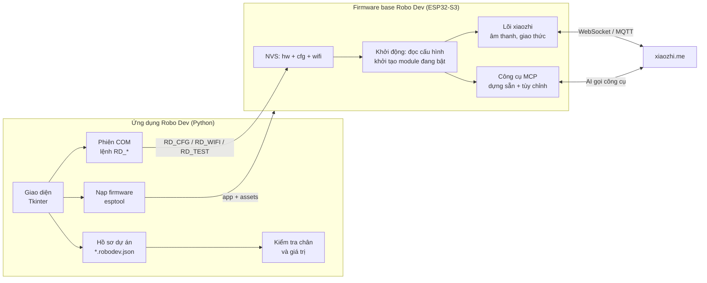

# Robo Dev v1: tài liệu thiết kế

Bản nháp, 16/10/2026. Đây là tài liệu thiết kế trước khi viết code. Chỗ nào chưa kiểm chứng trên mạch thật được đánh dấu **[cần kiểm chứng]**.

## 1. Mục tiêu

Robo Dev là phần mềm Windows viết bằng Python, giúp người mới làm quen lập trình firmware ESP32 dựng được một robot AI nói chuyện qua xiaozhi.me mà không phải cài ESP-IDF hay sửa code C++.

Robo Dev gồm hai phần đi cùng nhau:

- **Firmware base Robo Dev**: một firmware dựa trên xiaozhi-esp32, chạy trên ESP32-S3. Chân GPIO, tính năng và lệnh điều khiển đều đọc từ cấu hình lưu trong mạch (NVS) lúc khởi động, không ghi cứng khi biên dịch.
- **Ứng dụng Robo Dev** (Python): nạp và cập nhật firmware, cài Wi-Fi, kích hoạt xiaozhi.me, xem log, kiểm tra từng module, chỉnh chân, tính năng và lệnh, rồi gửi cấu hình xuống mạch.

Một firmware dùng chung cho mọi người dùng v1. Đổi chân hay đổi lệnh chỉ cần gửi cấu hình qua cổng COM rồi khởi động lại mạch, không biên dịch lại.

**Người dùng:** người mới học ESP32. Họ biết cắm dây theo sơ đồ nhưng chưa biết ESP-IDF.

**Thành công của v1:** một người chưa từng thấy mã nguồn tự làm được hết các bước sau chỉ bằng Robo Dev: nối dây theo cách của mình, khai báo chân, nạp, kiểm tra từng module, kết nối xiaozhi.me và thêm một lệnh điều khiển mới cho AI.

## 2. Phạm vi v1

### Phần cứng hỗ trợ

| Nhóm | Linh kiện | Giao tiếp | Ghi chú |
| --- | --- | --- | --- |
| Vi điều khiển | ESP32-S3-N16R8 (flash 16 MB, PSRAM 8 MB octal), devkit 2 cổng USB-C | - | Chỉ đúng chip và dung lượng này; mạch khác bị từ chối nạp |
| Mic | INMP441 | I2S (WS, SCK, SD) | L/R nối GND |
| Khuếch đại + loa | MAX98357A | I2S (LRC, BCLK, DIN) | Bộ I2S riêng với mic (simplex) |
| Màn hình | ST7789 240x240 1,54" | SPI (SCL, SDA, DC, RST, CS tùy chọn) | Module 7 chân không có CS: CS nối GND |
| Cảm biến khoảng cách | VL53L0X **hoặc** VL6180X | I2C (SDA, SCL), địa chỉ 0x29 | Firmware tự nhận loại cảm biến |
| Động cơ | 2 động cơ DC qua mạch cầu H 4 ngõ vào | 4 kênh PWM (IN1-IN4) | Đảo chiều, hoán đổi bánh bằng cấu hình |
| LED | WS2812 onboard | RMT, 1 chân | Mặc định GPIO48 |
| Nút | BOOT | GPIO0 | Bắt đầu/kết thúc hội thoại |

Mỗi module trừ ESP32 là **tùy chọn**: người dùng tắt module không có và firmware bỏ qua phần đó.

### Chức năng của ứng dụng

1. Nạp firmware lần đầu, cập nhật firmware, cài Wi-Fi, kích hoạt xiaozhi.me.
2. Xem log trực tiếp, kiểm tra từng chức năng (loa, mic, màn hình, cảm biến, động cơ, LED, nút).
3. Chỉnh nối chân, tính năng, thông số và lệnh điều khiển, rồi gửi xuống mạch.

### Ngoài phạm vi v1

- Board và linh kiện khác danh sách trên (ví dụ màn hình ILI9341, servo, camera). Thiết kế dữ liệu vẫn để chừa chỗ thêm sau.
- Viết driver mới hay code C++ từ trong ứng dụng.
- Sửa tính cách AI trên xiaozhi.me: việc đó làm trên website. Ứng dụng chỉ cung cấp mẫu prompt để sao chép.
- Lệnh giọng nói chạy trực tiếp trên mạch không qua AI.
- macOS và Linux. Code Python nên viết để chạy được đa nền tảng, nhưng v1 chỉ kiểm thử và đóng gói cho Windows.

## 3. Kiến trúc



Hai đường đưa thay đổi xuống mạch:

| Đường | Khi nào | Làm gì | Wi-Fi |
| --- | --- | --- | --- |
| **Cấu hình** (mặc định) | Đổi chân, bật/tắt module, thông số, lệnh tùy chỉnh, màu LED | Gửi JSON qua COM bằng `RD_CFG`, mạch lưu NVS rồi khởi động lại | Giữ nguyên |
| **Nạp** | Lần đầu, cập nhật phiên bản, đổi cụm gọi (wake word) | Ghi file firmware bằng esptool | Nạp nhanh giữ Wi-Fi; nạp đầy đủ thì xóa Wi-Fi, ứng dụng gửi lại |

Đường "biên dịch lại bằng ESP-IDF" chỉ dành cho nhà phát triển Robo Dev (build bản phát hành), không bắt người dùng v1 làm. Ứng dụng có chế độ nâng cao gọi ESP-IDF nếu máy có sẵn, dùng lại bộ chạy build của Voi Studio.

## 4. Firmware base Robo Dev

### 4.1 Nguồn gốc

Firmware là bản copy của xiaozhi-esp32 trong workspace (upstream `78/xiaozhi-esp32`, commit `e076ac4`) cùng các sửa đổi đã chạy thật trên mạch:

- `main/audio/audio_service.*`: thêm `PlayPcm()` để phát âm thanh thử và chuông.
- `main/audio/codecs/no_audio_codec.*`: chỉnh cho codec simplex.
- `main/assets/locales/vi-VN/language.json`: 15 chuỗi tiếng Việt đã sửa.
- Board `ai-box-robot-s3cam`: đây là điểm xuất phát cho board mới `robo-dev-s3`.

Theo quy tắc của xiaozhi-esp32, danh tính board ảnh hưởng tương thích OTA. Vì vậy Robo Dev dùng tên board riêng `robo-dev-s3` và không sửa board cũ.

### 4.2 Cấu hình chân lúc chạy

Bản tham khảo đọc chân từ hằng số trong `config.h`. Tuy vậy, mọi driver đang dùng đều nhận số chân lúc khởi tạo: `NoAudioCodecSimplex` (I2S), `spi_bus_initialize` (LCD), `i2c_new_master_bus` (cảm biến), `ledc_channel_config` (động cơ), led_strip (WS2812), `Button` (nút). Nhờ ma trận GPIO của ESP32-S3, các ngoại vi này gán được vào hầu hết chân. Việc cần làm là thay hằng số bằng giá trị đọc từ NVS trước khi khởi tạo. **[cần kiểm chứng: đổi chân từng module qua cấu hình trên mạch thật mà không build lại]**

Thứ tự khởi động:

1. Đọc `hw` (chân, module bật/tắt) và `cfg` (tính năng, lệnh) từ NVS. Chưa có thì dùng mặc định (mục 4.3).
2. Firmware tự kiểm tra lại cấu hình chân (cùng luật với ứng dụng, mục 5). Nếu sai, nó bỏ qua module lỗi, ghi log `RD_HW_ERR <lý do>` và vẫn khởi động phần còn lại, để mạch không bao giờ bị khóa vì cấu hình hỏng.
3. Khởi tạo các module đang bật, dò cảm biến ở địa chỉ 0x29 (VL53L0X: thanh ghi 0xC0 = 0xEE; VL6180X: thanh ghi 0x000 = 0xB4; đoạn này đã có trong code tham khảo, kể cả phát hiện SDA/SCL bị đảo).
4. Đăng ký công cụ MCP: công cụ dựng sẵn của module đang bật, rồi đến lệnh tùy chỉnh.

### 4.3 Cổng log và hai biến thể firmware

Devkit có hai cổng USB-C: cổng COM qua chip CH343 (UART0, GPIO43/44) và cổng USB native (USB-Serial-JTAG, GPIO19/20). Console cho log và lệnh `RD_*` được chọn lúc biên dịch (`CONFIG_ESP_CONSOLE_*`), nên v1 phát hành **hai biến thể** của cùng một firmware:

| Biến thể | Console | Chân bị khóa |
| --- | --- | --- |
| `robo-dev-s3-uart` | Cổng COM CH343 | GPIO43, 44 |
| `robo-dev-s3-usb` | Cổng USB native | GPIO19, 20 |

Ứng dụng nhận biết cổng người dùng đang cắm qua USB VID (CH343 `1A86`, USB native Espressif `303A`), rồi chọn biến thể tương ứng và khóa đúng các chân đó trong bộ kiểm tra. `serial_setup.h` tham khảo đã có cả hai nhánh UART và USB-Serial-JTAG.

Chân mặc định lấy theo cách nối trên mạch đang chạy (`config.h` của `ai-box-robot-s3cam`, biến thể USB vì LCD dùng GPIO43/44):

| Module | Tín hiệu | GPIO mặc định |
| --- | --- | --- |
| Mic INMP441 | WS / SCK / SD | 4 / 5 / 6 |
| MAX98357A | LRC / BCLK / DIN | 16 / 15 / 7 |
| ST7789 | SCL / SDA / DC / RST / CS | 2 / 1 / 43 / 44 / không dùng |
| Cảm biến | SDA / SCL | 12 / 13 |
| Động cơ | IN1 / IN2 / IN3 / IN4 | 17 / 18 / 3 / 14 |
| LED WS2812 | DIN | 48 |
| Nút BOOT | - | 0 |

Biến thể UART không dùng được GPIO43/44, nên nó cần một bộ chân mặc định khác cho DC/RST của LCD. Tài liệu Voi Studio cũ có một bảng nối khác (LCD 19/20/21/47...) cho cách nối dùng cổng COM. **[cần kiểm chứng: bảng nào đúng với mạch thật, xem `docs/hardware.md`]**

### 4.4 Dữ liệu cấu hình

Cấu hình gồm hai khối JSON lưu tách nhau trong NVS, để khi gửi lệnh mới không phải gửi lại chân:

```json
{
  "schema": 1,
  "hw": {
    "variant": "usb",
    "mic":     { "enabled": true, "ws": 4, "sck": 5, "sd": 6 },
    "speaker": { "enabled": true, "lrc": 16, "bclk": 15, "din": 7 },
    "lcd":     { "enabled": true, "scl": 2, "sda": 1, "dc": 43, "rst": 44, "cs": -1,
                 "spi_mode": 3, "clock_mhz": 10, "invert": true, "mirror_x": false,
                 "mirror_y": false, "swap_xy": false, "offset_x": 0, "offset_y": 0 },
    "sensor":  { "enabled": true, "type": "auto", "sda": 12, "scl": 13 },
    "motors":  { "enabled": true, "in1": 17, "in2": 18, "in3": 3, "in4": 14,
                 "invert_left": false, "invert_right": false, "swap_sides": false },
    "led":     { "enabled": true, "pin": 48, "count": 1, "order": "GRB" },
    "button":  { "pin": 0 }
  }
}
```

`cfg` giữ nguyên cấu trúc đã chạy được của `VoiConfig` (`features`, `motors`, `obstacle`, `emotion_motion`, `wander`, `led`, `mcp_tools`) và thêm `commands` cho lệnh tùy chỉnh (mục 6). `-1` nghĩa là không dùng chân. Có `schema` để firmware mới đọc được cấu hình cũ: mỗi lần đổi cấu trúc phải viết đoạn chuyển đổi. Khóa NVS là API lâu dài, không đổi tên tùy tiện.

Giới hạn cần tôn trọng: vùng NVS chỉ có 16 KB (0x4000) và mỗi dòng lệnh COM tối đa 4096 byte (`kMaxLine`). Hồ sơ lớn phải gửi thành nhiều mảnh có kiểm tra CRC (mục 4.5). Ứng dụng báo trước nếu tổng kích thước vượt ngưỡng an toàn.

### 4.5 Lệnh COM `RD_*`

Lệnh và trả lời đều là một dòng, đổi tiền tố `VOI_` của bản tham khảo thành `RD_`. Mạch không trả lời `RD_PING` nghĩa là không phải firmware Robo Dev.

| Lệnh | Trả lời | Dùng để |
| --- | --- | --- |
| `RD_PING` | `RD_PONG <phiên bản> <biến thể>` | Nhận diện firmware |
| `RD_INFO` | `RD_INFO {json}`: chip, flash, PSRAM, phiên bản, biến thể, cảm biến tìm thấy, Wi-Fi, trạng thái kích hoạt, module khởi tạo lỗi | Tab Thiết bị |
| `RD_HW {json}` / `RD_HW_GET` / `RD_HW_CLEAR` | `RD_HW_OK` hoặc `RD_HW_ERR <lý do>` | Ghi / đọc / xóa cấu hình chân |
| `RD_CFG {json}` / `RD_CFG_GET` / `RD_CFG_CLEAR` | `RD_CFG_OK` hoặc `RD_CFG_ERR <lý do>` | Ghi / đọc / xóa tính năng và lệnh |
| `RD_PART <n>/<tổng> <crc> <dữ liệu>` | `RD_PART_OK <n>` | Gửi cấu hình dài thành nhiều mảnh |
| `RD_WIFI {"s":..,"p":..}` / `RD_WIFI_CLEAR` | `RD_WIFI_OK` | Cài / xóa Wi-Fi |
| `RD_TEST <module> <bước>` | `RD_TEST_OK ...` hoặc `RD_TEST_ERR ...` | Kiểm tra module (mục 7) |
| `RD_RUN <lệnh tùy chỉnh>` | `RD_RUN_OK` | Chạy thử một lệnh tùy chỉnh không qua AI |
| `RD_VOL [0-100]` | `RD_VOL_OK <âm lượng>` | Âm lượng loa |
| `RD_REBOOT` | (khởi động lại) | Áp dụng cấu hình |

Lệnh COM không xác thực. v1 chấp nhận điều này vì muốn cấu hình phải cắm cáp trực tiếp vào mạch.

### 4.6 Bố cục bộ nhớ flash

Giữ bảng phân vùng 16 MB đang dùng: `nvs` 0x9000 (16 KB), `otadata` 0xd000, `phy_init` 0xf000, `ota_0` 0x20000 (≈4 MB), `ota_1` (≈4 MB), `assets` 0x800000 (8 MB, chứa model wake word, font, ảnh cảm xúc). Bản tham khảo dùng khoảng 2,7 MB trong ô ứng dụng 4 MB.

## 5. Luật kiểm tra chân (ESP32-S3-N16R8)

Ứng dụng kiểm tra trước khi gửi, firmware kiểm tra lại khi khởi động. Cả hai dùng chung một bảng luật, viết thành file dữ liệu `board-esp32s3-n16r8.json` để dễ sửa và để v2 thêm board khác.

| Chân | Luật | Lý do |
| --- | --- | --- |
| 26-32 | Cấm | Nối flash/PSRAM bên trong module |
| 33-37 | Cấm | PSRAM octal trên biến thể R8 |
| 43, 44 | Cấm ở biến thể `uart` | UART0, cổng log và nạp |
| 19, 20 | Cấm ở biến thể `usb` | USB native D-/D+ |
| 0 | Chỉ dùng cho nút BOOT | Chân strapping chọn chế độ nạp |
| 3, 45, 46 | Cảnh báo, cho dùng nếu người dùng xác nhận | Chân strapping. GPIO45 bị kéo lên lúc khởi động có thể làm mạch không chạy; GPIO46 phải ở mức thấp khi vào chế độ nạp |
| 48 | Gợi ý cho LED onboard | Devkit nối sẵn WS2812 |
| Mọi chân | Không gán hai tín hiệu vào một chân | Trừ khi hai module dùng chung bus (v1 chưa có) |

**[cần kiểm chứng]** từng dòng với datasheet ESP32-S3 và sơ đồ devkit đang dùng. Bản tham khảo đang dùng GPIO3 (động cơ IN3) và mạch vẫn chạy, nên GPIO3 chỉ để mức cảnh báo.

Thông báo lỗi phải nói rõ bằng lời thường cho người mới, ví dụ: "GPIO44 đang là cổng log của cổng COM. Nếu dùng chân này cho LCD, bạn sẽ mất log. Hãy chọn chân khác hoặc chuyển sang cắm cổng USB native."

## 6. Lệnh điều khiển tùy chỉnh

AI trên xiaozhi.me điều khiển robot bằng công cụ MCP, kiểu `self.robot.forward`. Có hai loại công cụ:

**Công cụ dựng sẵn.** Mỗi module đang bật tự đăng ký công cụ của nó. Người dùng bật/tắt từng công cụ, sửa mô tả (AI đọc mô tả để biết khi nào gọi) và sửa giá trị mặc định. Phần này đã chạy ở bản tham khảo qua `mcp_tools`.

| Module | Công cụ |
| --- | --- |
| Động cơ | `self.robot.forward`, `backward`, `turn_left`, `turn_right`, `stop`, `set_wander` |
| Cảm biến | `self.robot.get_distance` |
| Màn hình | `self.screen.set_rotation`, `set_status_bar`, `distance_mode`, `show_details` |
| Loa | `self.audio_speaker.set_volume` (có sẵn trong xiaozhi) |

**Lệnh tùy chỉnh (mới).** Người dùng tự tạo công cụ mới bằng cách ghép các bước có sẵn, không viết code. Firmware có một bộ thông dịch nhỏ chạy lần lượt từng bước trong một task riêng. Task này không chặn vòng lặp chính và âm thanh, và lệnh `stop` dừng được nó giữa chừng.

```json
"commands": {
  "chao_hoi": {
    "description": "Robot vẫy chào: xoay qua lại và nháy đèn xanh. Gọi khi người dùng chào robot.",
    "params": {},
    "steps": [
      { "led": [0, 200, 0] },
      { "move": "turn_left",  "speed": 60, "ms": 300 },
      { "move": "turn_right", "speed": 60, "ms": 300 },
      { "led": "off" }
    ]
  },
  "nhay_mua": {
    "description": "Robot nhảy múa trong số giây yêu cầu.",
    "params": { "seconds": { "type": "int", "min": 1, "max": 10, "default": 3 } },
    "steps": [ { "repeat": "seconds", "do": [
      { "move": "turn_left", "speed": 70, "ms": 500 },
      { "move": "turn_right", "speed": 70, "ms": 500 } ] } ]
  }
}
```

Công cụ được đăng ký với tên `self.custom.<tên>`. Tên chỉ gồm chữ thường không dấu, số và `_`.

Các bước có trong v1:

| Bước | Ý nghĩa |
| --- | --- |
| `move` + `speed` + `ms` | forward, backward, turn_left, turn_right, spin_left, spin_right, stop |
| `led` | Màu `[r,g,b]`, `"off"` hoặc trở về màu theo trạng thái |
| `emotion` | Hiện biểu cảm trên LCD (happy, sad, surprised...) |
| `beep` | Phát âm ngắn, có tần số và thời gian |
| `wait` | Chờ ms |
| `repeat` | Lặp các bước theo số lần hoặc theo tham số |
| `if_distance_below` | Chỉ chạy các bước con khi vật cản gần hơn N mm |

Giới hạn để mạch luôn an toàn: tối đa 16 lệnh, mỗi lệnh 32 bước, lồng `repeat` tối đa 2 cấp, mỗi lần chạy tối đa 30 giây. Mọi bước `move` vẫn chịu luật dừng khi gặp vật cản. Ứng dụng có nút **Chạy thử** (gửi `RD_RUN`) để người dùng xem robot làm gì trước khi giao cho AI.

## 7. Kiểm tra chức năng

Đây là chỗ người mới hay nối sai dây nhất. Tab Kiểm tra có trình hướng dẫn chạy từng module bằng `RD_TEST`, và mỗi bước có câu hỏi xác nhận cho những thứ máy tính không tự đo được:

| Module | Bước kiểm tra | Phát hiện được |
| --- | --- | --- |
| Loa | Phát âm thử 1 kHz; hỏi "Bạn có nghe thấy không?" | Sai LRC/BCLK/DIN, loa không kêu |
| Mic | Thanh đo mức âm thanh trực tiếp; yêu cầu vỗ tay | Mic không có tín hiệu, sai WS/SCK/SD, L/R |
| LCD | Hiện dải màu đỏ/xanh/lam và khung viền | Sai chân, lệch, đảo màu (sửa ngay `invert`, `offset`) |
| Cảm biến | Đọc khoảng cách liên tục; đưa tay lại gần | Không trả lời trên I2C, đảo SDA/SCL, loại cảm biến |
| Động cơ | Từng bánh quay chậm từng chiều; hỏi "Bánh nào quay, chiều nào?" | Đảo chiều, hoán đổi trái/phải (áp ngay vào cấu hình) |
| LED | Đỏ, xanh lá, xanh dương, trắng | Không sáng, sai thứ tự màu (RGB/GRB) |
| Nút BOOT | "Hãy bấm nút BOOT" | Nút không phản hồi |
| Wi-Fi + xiaozhi.me | Kết nối, đọc trạng thái kích hoạt | Sai mật khẩu, chưa liên kết |

Khi một module lỗi, ứng dụng làm nổi bật các dây liên quan trong bảng nối chân và gợi ý chỗ cần kiểm tra.

Cạnh trình hướng dẫn là khung **log trực tiếp**: lọc theo mức (lỗi/cảnh báo/thông tin), tìm kiếm, tạm dừng cuộn, lưu ra file. Có ô gửi lệnh `RD_*` thủ công cho người muốn tìm hiểu sâu hơn.

## 8. Nạp, cập nhật và kích hoạt

| Chế độ | Ghi vùng nào | Wi-Fi + cấu hình | Khi nào |
| --- | --- | --- | --- |
| Nạp đầy đủ | Toàn bộ từ 0x0 (`merged-binary.bin`) | Mất (NVS bị ghi đè), ứng dụng gửi lại | Mạch mới, đổi biến thể, sửa lỗi nặng |
| Nạp nhanh | `ota_0` tại 0x20000 + `otadata` 0xd000, thêm `assets` 0x800000 khi cần | Giữ nguyên | Cập nhật phiên bản, đổi wake word |

Các bước trên đã chạy thật ở Voi Studio (nạp đầy đủ 13,5 MB mất 149 giây qua COM; nạp nhanh giữ được Wi-Fi). Robo Dev dùng lại phần code đó.

Trước khi ghi, ứng dụng đọc chip và dung lượng flash. Nếu không phải ESP32-S3 16 MB thì từ chối và nói rõ lý do. Nạp nhanh chỉ được phép khi bảng phân vùng trên mạch khớp (so MD5).

Sau khi nạp, ứng dụng tự chạy lần lượt: `RD_PING` → gửi `RD_HW` và `RD_CFG` từ hồ sơ → `RD_WIFI` → theo dõi log đến khi kích hoạt xong, hiện mã kích hoạt 6 số và nút mở xiaozhi.me. Tên Wi-Fi được nhớ, mật khẩu không lưu. Nếu không có mã, thường là do thiết bị còn liên kết với một agent cũ. Khi đó ứng dụng hiện hướng dẫn hủy liên kết trên xiaozhi.me (lỗi này đã gặp thật).

**Cập nhật firmware:** bản phát hành được đăng lên GitHub Releases của repo Robo Dev, gồm hai biến thể và file `manifest.json` (phiên bản, MD5, `schema` cấu hình). Ứng dụng kiểm tra bản mới, tải về, kiểm tra MD5 rồi nạp nhanh. Nếu `schema` thay đổi, ứng dụng chuyển đổi hồ sơ và gửi lại cấu hình. Người dùng vẫn chọn được file `.bin` từ máy để nạp offline.

**OTA của xiaozhi.me:** máy chủ không có firmware cho board `robo-dev-s3`, nên OTA từ máy chủ sẽ không trả về bản nào; luồng kích hoạt vẫn dùng endpoint OTA như cũ. **[cần kiểm chứng: board mới vẫn kích hoạt bình thường và không bị máy chủ đẩy firmware khác]**

**Wake word:** ESP-SR không có model tiếng Việt, nên cụm gọi luôn là phiên âm gần đúng (mặc định `hei li li`, hiển thị "Hey Lily"). Cụm gọi nằm trong phân vùng assets. v1 phát hành sẵn vài gói assets cho một số cụm gọi để người dùng chọn rồi nạp riêng assets. Cụm gọi tự đặt cần chế độ nâng cao (ESP-IDF). **[cần kiểm chứng: tạo `assets.bin` không cần ESP-IDF]**

## 9. Giao diện

Nguyên tắc: một màn hình làm một việc; luôn có nút bước tiếp theo; thuật ngữ kỹ thuật đi kèm lời giải thích ngắn; không bao giờ để người dùng không biết bấm xong sẽ xảy ra gì.

Bố cục: thanh bên trái gồm 6 bước theo thứ tự, mỗi bước có dấu ✔ khi xong. Thanh trạng thái phía dưới luôn hiện cổng COM, firmware, phiên bản, Wi-Fi và kích hoạt. Phía trên có công tắc **Cơ bản / Nâng cao**: chế độ cơ bản ẩn thông số LCD, mức log, lệnh thủ công và build ESP-IDF.

| Bước | Nội dung |
| --- | --- |
| 1. Thiết bị | Chọn cổng COM (tự dò), nút "Kiểm tra mạch" (chip, flash, firmware, biến thể). Ảnh linh kiện và sơ đồ nối dây mẫu |
| 2. Nối chân | Mỗi module là một thẻ có công tắc bật/tắt, ảnh, thứ tự chân in trên linh kiện và ô chọn GPIO. Hình devkit tô màu chân đã dùng, chân cấm và chân cảnh báo. Lỗi hiện ngay khi chọn. Nút "Dùng chân mặc định" |
| 3. Tính năng | Bật/tắt và thông số: dừng khi vật cản, cử động theo cảm xúc, đi dạo, tốc độ, màu LED theo trạng thái. Mục phụ thuộc tự xám khi tắt mục chính |
| 4. Lệnh | Danh sách công cụ dựng sẵn (bật/tắt, mô tả) và trình soạn lệnh tùy chỉnh: thêm bước bằng nút, kéo đổi thứ tự, Chạy thử. Thư viện mẫu prompt cho xiaozhi.me |
| 5. Nạp & kết nối | Nút **Áp dụng** gửi cấu hình. Nạp đầy đủ / nạp nhanh / cập nhật. Nhập Wi-Fi, mã kích hoạt |
| 6. Kiểm tra | Trình hướng dẫn kiểm tra từng module và log trực tiếp |

Hồ sơ dự án lưu thành file `*.robodev.json` (chân + cấu hình + tên robot), mở lại được và dùng cho nhiều mạch. Nút **Áp dụng** luôn nói trước nó sẽ làm gì ("Chỉ gửi cấu hình, mạch khởi động lại, Wi-Fi giữ nguyên"). Sau khi áp dụng, ứng dụng đọc lại `RD_HW_GET` / `RD_CFG_GET` để xác nhận mạch đang dùng đúng hồ sơ.

Công nghệ: Tkinter + ttk, cùng nền với Voi Studio vì đã đóng gói được bằng PyInstaller thành một file `.exe`. Mọi việc chạy lâu (nạp, kiểm tra, đọc log) chạy trong luồng nền, gửi sự kiện về giao diện qua hàng đợi, nên giao diện không bao giờ bị treo.

## 10. Cấu trúc thư mục và mã nguồn copy vào

Robo Dev tự chứa: mọi mã nguồn tham khảo cần dùng được **copy vào** `Robo-Dev/`, không trỏ ra thư mục khác trong workspace. Sau khi copy, các thư mục cũ chỉ còn để đối chiếu.

```
Robo-Dev/
  document.md               tài liệu này
  CLAUDE.md, README.md
  firmware/                 dự án ESP-IDF (copy từ xiaozhi-esp32)
    main/boards/robo-dev-s3/  board mới, phát triển từ ai-box-robot-s3cam
    UPSTREAM.md             commit upstream gốc + danh sách sửa đổi lõi
  app/                      ứng dụng Python
    robodev/
      main.py               điểm vào
      ui/                   các màn hình (mỗi bước một file)
      link.py               esptool, phiên COM, theo dõi kích hoạt
      jobs.py               chuỗi việc nạp / áp dụng / kiểm tra
      profile.py            hồ sơ, mặc định, chuyển đổi schema
      pins.py               luật kiểm tra chân
      advanced.py           build bằng ESP-IDF (tùy chọn)
      data/                 board-esp32s3-n16r8.json, modules/*.json, ảnh, mẫu prompt
    tests/                  kiểm thử pins.py, profile.py, mô phỏng giao thức RD_*
    requirements.txt        esptool, pyserial, Pillow
    build_exe.py            đóng gói PyInstaller
  docs/                     phần cứng, sơ đồ nối dây, hướng dẫn người dùng
  releases/                 (không commit) file firmware build ra
```

Nguồn copy:

| Từ | Đến | Ghi chú |
| --- | --- | --- |
| `xiaozhi-esp32/` (trừ `build/`, `managed_components/`, `sdkconfig*`, `.git`) | `firmware/` | Giữ sửa đổi lõi; ghi commit `e076ac4` vào `UPSTREAM.md` |
| `xiaozhi-esp32/main/boards/ai-box-robot-s3cam/` | `firmware/main/boards/robo-dev-s3/` | Đổi tên lớp, `voi_*` thành `rd_*`, `VOI_` thành `RD_`; thêm Kconfig/CMake/`config.json` cho board mới với hai biến thể |
| `Voi-Studio/studio/link.py`, `jobs.py`, `advanced.py`, `voi_profile.py`, `devices.py` | `app/robodev/` | Lõi nạp, phiên COM, kích hoạt đã chạy thật; đổi giao thức sang `RD_*` |
| `Voi-Studio/studio/app.py` | tham khảo cho `app/robodev/ui/` | Viết lại theo bố cục 6 bước |
| `Voi-Studio/assets/photos/`, `so-do-noi-day-voi.png` | `app/robodev/data/` | Ảnh linh kiện |
| `Voi-Studio/build_exe.py`, `package_firmware.py` | `app/` | Đóng gói |

Code tham khảo còn có một số tính năng chưa nằm trong yêu cầu v1: chuông báo giờ (`alarm_chime.h`), trò chơi rắn (`snake_scene.h`), thời tiết (`voi_weather.h`). Đề xuất copy theo nhưng để tắt mặc định (xem câu hỏi mở).

Upstream xiaozhi-esp32 có khoảng 50 thư mục board (nhiều board có nhiều biến thể). Ban đầu cứ giữ nguyên để không phải sửa chuỗi `Kconfig`/`CMakeLists`. Sau khi board `robo-dev-s3` build được, có thể dọn bớt để repo gọn hơn.

## 11. Lộ trình

Mỗi giai đoạn chỉ bắt đầu khi cổng kiểm thử của giai đoạn trước đã qua trên mạch thật. Chưa gán ngày vì chưa có ước lượng công sức.

| Giai đoạn | Nội dung | Cổng kiểm thử |
| --- | --- | --- |
| 0. Dựng repo | Copy mã nguồn (mục 10); board `robo-dev-s3` build ra firmware chạy y hệt bản tham khảo | Nạp, kích hoạt xiaozhi.me, nói chuyện được |
| 1. Chân lúc chạy | Khối `hw` trong NVS, `RD_HW*`, `RD_INFO`, kiểm tra chân trong firmware, hai biến thể | Đổi chân một module qua COM, module vẫn chạy mà không build lại; cấu hình sai không làm mạch treo |
| 2. Ứng dụng lõi | Bước 1, 2, 5 của giao diện: dò mạch, nối chân có kiểm tra, nạp, Wi-Fi, kích hoạt | Mạch sạch kích hoạt xong chỉ bằng ứng dụng |
| 3. Kiểm tra + tính năng | `RD_TEST`, trình hướng dẫn kiểm tra, log, bước 3 | Phát hiện được đảo bánh, sai chân LCD, đảo SDA/SCL |
| 4. Lệnh tùy chỉnh | Bộ thông dịch bước, `RD_RUN`, trình soạn lệnh, bước 4 | AI gọi được một lệnh tùy chỉnh mới tạo |
| 5. Phát hành | Cập nhật qua GitHub Releases, gói wake word, đóng gói `.exe`, hướng dẫn người dùng | Một người mới tự làm từ đầu đến cuối không cần hỗ trợ |

## 12. Kiểm thử

- **Ứng dụng:** kiểm thử tự động cho luật chân, hồ sơ và chuyển đổi schema, cùng một mạch giả lập trả lời `RD_*` để chạy các chuỗi việc mà không cần phần cứng.
- **Firmware:** build cả hai biến thể trong mỗi lần phát hành; kiểm tra bộ đọc cấu hình với JSON hỏng, thiếu khóa, giá trị ngoài khoảng.
- **Trên mạch thật**, các ca chấp nhận v1:
  - Mạch sạch: nạp đầy đủ, Wi-Fi, kích hoạt, nói chuyện.
  - Đổi chân động cơ sang chân khác, áp dụng, động cơ vẫn chạy.
  - Chọn chân cấm: ứng dụng chặn; gửi thẳng `RD_HW` sai: firmware từ chối, mạch vẫn khởi động.
  - Tắt cảm biến và LCD: firmware chạy, không đăng ký công cụ liên quan.
  - Thay VL53L0X bằng VL6180X: tự nhận, đọc đúng khoảng cách.
  - Tạo lệnh tùy chỉnh, Chạy thử, rồi nhờ AI gọi bằng giọng nói.
  - Cập nhật bằng nạp nhanh: giữ Wi-Fi và cấu hình.
  - Mạch khác (ESP32-C3, flash 8 MB): từ chối nạp.
  - Rút cáp giữa lúc nạp: báo lỗi, cắm lại và nạp lại được.

## 13. Rủi ro

| Rủi ro | Ảnh hưởng | Cách giảm |
| --- | --- | --- |
| Có driver vẫn phụ thuộc chân lúc biên dịch | Phải sửa sâu hơn dự kiến | Giai đoạn 1 làm thử từng module trước khi làm giao diện |
| Bảng chân mặc định không khớp mạch thật (đang có hai bảng khác nhau) | Người dùng nối theo sơ đồ sai | Xác nhận trên mạch thật trước giai đoạn 2; ảnh rõ nhãn chân từng linh kiện |
| Người mới nối vào chân strapping, mạch không khởi động | Tưởng mạch hỏng | Cảnh báo trong ứng dụng; hướng dẫn "rút dây ra rồi cắm lại USB" |
| Lệnh tùy chỉnh chạy lâu hoặc lặp vô hạn | Robot chạy mãi, chiếm CPU | Giới hạn số bước, độ sâu và thời gian; `stop` luôn ngắt được |
| Cấu hình vượt 16 KB NVS hoặc 4096 byte một dòng | Không lưu được | Chia mảnh có CRC; đo kích thước trước khi gửi |
| Máy chủ xiaozhi.me xử lý board mới khác board cũ | Không kích hoạt hoặc bị OTA đè | Kiểm chứng ở giai đoạn 0 |
| Wake word phiên âm nhận kém | Phải bấm nút BOOT thay vì gọi | Nút "thử giọng", vài gói cụm gọi để thử |
| `.exe` chưa ký số | SmartScreen và antivirus cảnh báo | Ghi hướng dẫn; cân nhắc chứng chỉ ký số khi phát hành rộng |

## 14. Câu hỏi mở

1. **Bảng chân mặc định:** mạch đang dùng nối theo `config.h` (LCD trên GPIO43/44, log qua USB native) hay theo bảng cũ trong Voi Studio (log qua cổng COM)? Có cần phát hành cả hai biến thể ngay từ v1 không?
2. **Tên hiển thị:** robot mặc định tên gì ("Voi", "Robo"...)? Tên này dùng trong câu báo vật cản và mẫu prompt.
3. **Tính năng phụ** của bản tham khảo (chuông báo giờ, trò chơi rắn, thời tiết): giữ ở v1 (tắt mặc định) hay bỏ?
4. ~~**Repo GitHub:** có đổi tên repo thành `Robo-Dev` không?~~ Đã xong: repo là `zenix-vn/Robo-Dev`.
5. **Phát hành:** dùng GitHub Releases của repo này cho firmware và `.exe`, hay nơi khác?
6. **Ngôn ngữ giao diện:** chỉ tiếng Việt, hay cần thêm tiếng Anh từ v1?
